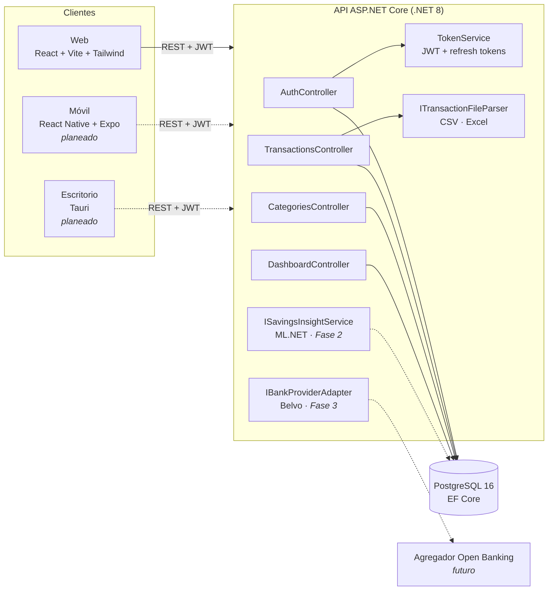

# Finance APP

> Documento de contexto para portafolio. Fuentes revisadas: código del monorepo (`backend/`, `web/`, `mobile/`, `desktop/`), historial Git (21 commits), `README.md`, `docs/ARCHITECTURE.md`, `docs/Finance_APP_EDT.xlsx`, los 4 documentos `.docx` de `docs/` y las notas del proyecto. Fecha de revisión: 05-nov-2026.

## Ficha rápida
- **Nombre público sugerido:** Finance APP — "App de finanzas personales con IA". El nombre ya es genérico y no expone a terceros, se puede usar tal cual.
- **Tipo:** API + web app + móvil (planeado) + IA/ML (planeado). Proyecto personal con miras a producto SaaS (suscripción freemium/premium).
- **Estado:** En desarrollo. Fase 1 (MVP): backend con 6 de 7 tareas completadas; web solo con scaffold (pantalla placeholder); móvil y escritorio sin inicializar (solo README con instrucciones). Último commit: 27-jul-2026 [VERIFICAR si el proyecto está pausado o sigue activo].
- **Periodo:** 24-jul-2026 – actual. (Primer commit y documentos: 24-jul-2026; último commit: 27-jul-2026.)
- **Mi rol:** Único desarrollador y dueño del producto: arquitectura, backend, planeación (EDT) y documentación. [VERIFICAR] La memoria del proyecto indica que el scaffold inicial del monorepo, los 4 documentos de `docs/` y la EDT se generaron en sesiones asistidas por IA; todos los commits están a mi nombre. Definir cómo presentarlo (ej. "desarrollo asistido por IA").
- **Tamaño del equipo:** 1 persona (único autor en el historial Git).
- **¿Se puede mostrar públicamente?:** Sí. Es un proyecto propio, sin cliente ni datos de terceros. Ojo: como la idea es venderlo como producto, conviene mostrar descripción, arquitectura y fragmentos de código puntuales, no necesariamente el repo completo [VERIFICAR si el repo es público o privado].

## Resumen en una frase
App para registrar ingresos y gastos, ver en qué se va la plata y, a futuro, recibir consejos de ahorro y predicciones de gasto con inteligencia artificial.

## Problema
Las personas (mercado inicial: Colombia/Latam) no tienen una forma sencilla de consolidar su gasto de distintas fuentes (efectivo, bancos, billeteras virtuales) ni de recibir recomendaciones personalizadas de ahorro. Según la documentación del proyecto, la alternativa para "trazar" gasto de billeteras como Google Wallet es limitada: Google Wallet no tiene API pública para que terceros lean el historial de transacciones, así que hoy el usuario depende de registrar a mano o exportar extractos.

Cómo se hacía antes: No disponible (no hay en el material una descripción del proceso previo del usuario objetivo ni investigación de usuarios).

## Solución
Un monorepo con un único backend ASP.NET Core (.NET 8) que expone una API REST para todas las plataformas (web, Android/iOS y escritorio), evitando duplicar reglas de negocio. El MVP permite registrarse, cargar transacciones manualmente o importarlas desde extractos CSV/Excel (con previsualización, errores por fila y detección de duplicados), organizarlas por categorías del sistema o personalizadas, y consultar un resumen mensual por categoría y la tendencia de ingresos/gastos de hasta 24 meses. La arquitectura deja definidos dos puntos de extensión: un motor de insights con ML.NET (detección de anomalías, forecasting, clustering) sin depender de APIs de LLM de pago, y un adaptador de Open Banking (Belvo para Latam) para traer movimientos bancarios directamente.

## Mis aportes concretos
- Definí el stack y la arquitectura multiplataforma (ASP.NET Core + PostgreSQL, React + Vite, React Native + Expo, Tauri, ML.NET), documentando el motivo de cada decisión. [VERIFICAR autoría — ver Ficha rápida]
- Diseñé el modelo de datos de 8 entidades (Usuario, Cuenta, Transacción, Categoría, Presupuesto, Regla de categorización, Refresh token, Categoría oculta) con EF Core y 5 migraciones.
- Implementé autenticación JWT con registro/login, hash de contraseñas (`PasswordHasher` de ASP.NET Core Identity) y refresh tokens persistidos, rotativos y revocables (logout).
- Implementé el CRUD de transacciones con filtros combinables (fechas, categoría, cuenta, monto, tipo ingreso/gasto), paginación y validación de pertenencia de cuenta/categoría al usuario autenticado.
- Construí un importador de extractos CSV y Excel en dos pasos (previsualizar → confirmar) con mapeo de columnas configurable, errores por fila y detección de duplicados contra el histórico.
- Implementé el CRUD de categorías combinando 13 categorías del sistema sembradas por migración con categorías personalizadas por usuario, y "ocultamiento" reversible de las del sistema.
- Desarrollé los endpoints de dashboard: resumen mensual (ingresos, gastos, balance, gasto por categoría) y tendencia de los últimos N meses.
- Configuré el entorno local reproducible con Docker Compose (PostgreSQL 16) y Swagger para pruebas de la API.
- Planeé el proyecto completo en una EDT de 6 fases (Fase 0 a 5) con cronograma estimado de ~50 semanas, y llevé el estado de cada tarea sincronizado con los commits. [VERIFICAR autoría]
- Documenté la especificación funcional del MVP (12 historias de usuario con criterios de aceptación), el ERD y lineamientos de seguridad y cumplimiento (Ley 1581/2012 Habeas Data, requisitos de Google Play para apps financieras). [VERIFICAR autoría]
- Investigué y documenté la limitación técnica de Google Wallet y las alternativas (import CSV, `NotificationListenerService` en Android, Open Banking).

## Stack tecnológico
- **Frontend:** React 19, Vite 8, Tailwind CSS v4, TypeScript, React Router 7, oxlint (web en estado scaffold). Móvil: React Native + Expo (planeado, no inicializado). Escritorio: Tauri (planeado, no inicializado).
- **Backend:** ASP.NET Core Web API (.NET 8), Entity Framework Core 8, autenticación JWT Bearer, `PasswordHasher` de ASP.NET Core Identity, Swagger (Swashbuckle).
- **Base de datos:** PostgreSQL 16 (Npgsql + EF Core, migraciones code-first).
- **Infraestructura / Cloud / DevOps:** Docker Compose para la BD local; Git + GitHub. Hosting de producción no definido (candidatos documentados: Railway, Render o Azure). Carpeta `.github/workflows` creada pero vacía (sin CI configurado).
- **IA / LLMs / APIs externas:** ML.NET 4 y ML.NET TimeSeries referenciados en el proyecto, pero aún sin implementación (solo la interfaz `ISavingsInsightService`). Open Banking planeado con Belvo (Colombia/Latam); Salt Edge, Tink o TrueLayer si se expande a Europa. Sin LLMs por decisión explícita (evitar costos variables).
- **Herramientas y librerías clave:** CsvHelper (CSV), ClosedXML (Excel), Docker, Visual Studio, Excel (EDT/cronograma).

## Arquitectura
- **Clientes:** web (React), móvil (React Native) y escritorio (Tauri, que empaqueta la misma web) consumen una sola API REST. Hoy solo existe el scaffold web.
- **API ASP.NET Core:** 4 controladores, 19 endpoints:
  - `Auth`: registro, login, refresh y logout.
  - `Transactions`: CRUD + `import/preview` + `import/confirm`.
  - `Categories`: CRUD + `unhide`.
  - `Dashboard`: `summary` y `trend`.
- **Servicios:** `TokenService` (JWT y refresh tokens) y parsers de archivos que implementan `ITransactionFileParser` (CSV y Excel, resueltos por extensión).
- **Puertos para fases futuras:** `ISavingsInsightService` (ML.NET) e `IBankProviderAdapter` (Open Banking). Desacoplan el núcleo de proveedores externos.
- **Persistencia:** EF Core → PostgreSQL. Cada consulta filtra por el `sub` del JWT (aislamiento de datos por usuario).

## Desafíos técnicos y cómo los resolví
1. **Fechas y zonas horarias con Npgsql.**
   - Problema: Npgsql 8 exige `DateTime` con `Kind=Utc` para columnas `timestamptz`, y fallaba cuando el cliente mandaba solo una fecha (sin hora).
   - Decisión: mapear `Transaction.Date` como columna `date` pura, con su propia migración (`TransactionDateAsDateOnly`).
   - Resultado: las transacciones se guardan y filtran por día sin errores de zona horaria. [CONFIRMADO en commit y código]
2. **Importación de extractos sin ensuciar los datos.**
   - Problema: los extractos bancarios traen columnas distintas, filas inválidas y movimientos ya registrados.
   - Decisión: flujo en dos pasos. `preview` parsea con mapeo de columnas configurable, marca errores por fila y detecta duplicados (fecha + monto + descripción normalizada contra el histórico, usando un `HashSet`) sin guardar nada. `confirm` inserta solo las filas que el usuario aprobó. Los formatos se resuelven con un patrón estrategia (`ITransactionFileParser`), así que agregar uno nuevo no toca el controlador.
   - Resultado: el usuario revisa antes de importar y el sistema queda abierto a más formatos. [CONFIRMADO en código]
3. **Categorías compartidas vs. personalizadas.**
   - Problema: las categorías predefinidas son comunes a todos, pero cada usuario debe poder "quitarlas" sin afectar a los demás.
   - Decisión: las del sistema tienen `UserId` nulo e Ids fijos (sembradas con `HasData` para migraciones determinísticas). "Eliminar" una del sistema la oculta solo para ese usuario (tabla `HiddenCategory` con índice único), y es reversible con `/unhide`. Las personalizadas sí se borran.
   - Resultado: el catálogo se mantiene consistente y cada usuario conserva el control. [CONFIRMADO en código]
4. **Integraciones que no existen (Google Wallet) y dependencia de proveedores.**
   - Problema: no hay API pública para leer transacciones de Google Wallet, y los agregadores de Open Banking varían según el país.
   - Decisión: arrancar el MVP con registro manual + importación CSV/Excel (sin dependencias externas) y aislar la integración bancaria detrás de `IBankProviderAdapter`. Belvo queda como primer adaptador para Latam y Salt Edge/Tink/TrueLayer para Europa.
   - Resultado: el MVP no se bloquea por terceros y cambiar de agregador no toca el núcleo. [CONFIRMADO en documentación; la implementación del adaptador está pendiente]

Extra (menor): el handler JWT remapeaba el claim `sub`. Se desactivó `MapInboundClaims` y se lee `sub` con `FindFirst` para identificar al usuario de forma consistente. [CONFIRMADO en commit]

## Impacto y resultados
El producto no tiene usuarios ni despliegue todavía, así que **no hay métricas de impacto** (tiempo ahorrado, adopción, etc.): No disponible.

Métricas de alcance técnico verificables:
- 19 endpoints REST implementados en 4 controladores. [CONFIRMADO]
- 8 entidades de dominio y 5 migraciones EF Core. [CONFIRMADO]
- 13 categorías del sistema sembradas. [CONFIRMADO]
- 12 historias de usuario especificadas para el MVP (US-01 a US-12). [CONFIRMADO]
- Backend del MVP: 6 de 7 tareas completadas (pendientes: tests unitarios). [CONFIRMADO en la EDT]
- 21 commits entre el 24 y el 27 de julio de 2026 (backend del MVP en ~4 días). [CONFIRMADO en Git]
- Roadmap de 6 fases, estimado en ~50 semanas a 25–30 h/semana. [ESTIMADO, es una proyección, no un dato real]

Brechas a tener en cuenta (para no sobredimensionar en el portafolio):
- La especificación pide bloqueo temporal tras 5 intentos fallidos de login (US-02). No está implementado en el código.
- No hay tests unitarios.
- No hay CI.

## Habilidades demostradas
- **Técnicas:** ASP.NET Core Web API, Entity Framework Core, PostgreSQL, diseño de APIs REST, autenticación JWT y refresh tokens, modelado de datos (ERD), migraciones code-first, importación y validación de archivos (CSV/Excel), patrón estrategia, puertos y adaptadores, Docker Compose, React + Vite + Tailwind, arquitectura multiplataforma.
- **Producto y gestión:** definición de MVP, historias de usuario con criterios de aceptación, planeación con EDT y cronograma, roadmap por fases, toma de decisiones técnicas documentadas.
- **Seguridad y cumplimiento:** seguridad de datos financieros, Habeas Data (Ley 1581/2012), requisitos de Google Play para apps financieras.
- **Blandas:** autogestión, investigación técnica (Open Banking, limitaciones de plataforma), documentación.

## Material visual disponible
- **Diagrama ERD (PNG)**, embebido en `docs/Modelo_de_Datos_ERD.docx`. Se puede mostrar: no contiene datos sensibles.
- **Diagrama de arquitectura en Mermaid** (en este documento). Se puede renderizar directo en Astro.
- **EDT/cronograma** (`docs/Finance_APP_EDT.xlsx`). Se puede mostrar como captura o recrear como un roadmap visual.
- **Swagger UI de la API.** No hay capturas; habría que tomarlas corriendo el backend en local, sin datos reales.
- **UI web/móvil:** No disponible. La web es solo una pantalla placeholder y el móvil no existe aún; no hay capturas, demos ni videos.
- **Fragmentos de código destacables** (seguros de mostrar): el flujo `import/preview` → `import/confirm`, la interfaz `ITransactionFileParser` e `IBankProviderAdapter`.

## Textos listos para el portafolio
- **Tarjeta (máx. 40 palabras):** App de finanzas personales con IA, en desarrollo. Backend en ASP.NET Core 8 y PostgreSQL con autenticación JWT, importación de extractos CSV/Excel con detección de duplicados y dashboard mensual; arquitectura preparada para ML.NET y Open Banking.
- **Viñeta para CV (1 línea, con métrica si existe):** Construí el backend MVP de una app de finanzas personales (ASP.NET Core 8, EF Core, PostgreSQL): 19 endpoints REST, autenticación JWT con refresh tokens rotativos e importador CSV/Excel con detección de duplicados.
- **Párrafo de caso de estudio (80–120 palabras):** Finance APP es una app de finanzas personales para Colombia y Latam, en desarrollo, que busca dar consejos de ahorro y predicciones de gasto con modelos de ML propios, sin depender de APIs de pago. Como único desarrollador, definí un monorepo con un backend ASP.NET Core (.NET 8) que sirve a web, móvil y escritorio. Construí el backend del MVP: autenticación JWT con rotación de refresh tokens, CRUD de transacciones y categorías aislado por usuario, importador CSV/Excel con previsualización y detección de duplicados, y endpoints de resumen mensual y tendencia. El diseño deja listos puertos para ML.NET y Open Banking (Belvo) sin acoplar el núcleo a proveedores externos.

## Preguntas para mí
1. **Autoría y uso de IA:** el scaffold, los 4 documentos, la EDT y probablemente parte del código se generaron en sesiones asistidas por IA. ¿Qué escribiste tú directamente y cómo lo quieres presentar (ej. "desarrollo asistido por IA")?
2. **Estado real:** el último commit es del 27-jul-2026. ¿El proyecto sigue activo, está pausado o tienes avances fuera de este repo (web, móvil)?
3. **Visibilidad del repo:** ¿el repositorio de GitHub es público? ¿Quieres enlazarlo desde el portafolio o mantener el código privado porque piensas comercializarlo?
4. **Motivación y problema:** ¿nació de una necesidad tuya? ¿Hiciste alguna validación con usuarios potenciales o un análisis de competencia? Eso alimentaría la sección "Problema / cómo se hacía antes".
5. **Tiempo invertido:** ¿cuántas horas reales llevas? (La EDT solo tiene estimaciones.)
6. **Uso real:** ¿lo has usado con tus propias finanzas? ¿Hay algún dato (meses registrados, transacciones importadas) que puedas compartir de forma generalizada?
7. **Brechas del MVP:** ¿piensas implementar el bloqueo por intentos fallidos, los tests unitarios y el CI antes de publicar el caso de estudio?
8. **Despliegue:** ¿hay o habrá una demo desplegada (Railway/Render/Azure) que se pueda enlazar?
9. **Visuales:** ¿quieres que preparemos capturas de Swagger con datos ficticios o un mockup de la UI para el portafolio?
10. **Fases futuras:** ¿abriste cuenta sandbox en Belvo o probaste ML.NET? Si es así, se puede agregar como avance.
